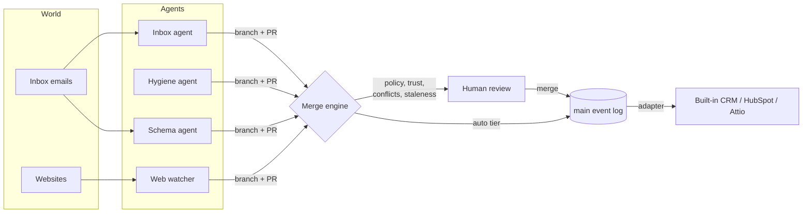

# Git CRM

**Agents never write to your CRM. They open pull requests against it.**

Git CRM is a version-control layer that sits in front of a CRM. Every AI agent that wants to change customer data (an inbox agent, a dedup agent, an enrichment agent, a schema agent) works on its own **branch** and opens a **pull request**. Git CRM three-way-merges those PRs into `main`, catches conflicts between agents, holds risky changes for a human, flags PRs whose evidence has gone **stale**, and lets you **revert**, **blame** and **time-travel** the whole CRM.

> 🔗 **Live app:** https://gitcrm-production.up.railway.app · **Landing page:** [`/landing`](https://gitcrm-production.up.railway.app/landing)
> Built in one evening at **Night Hack by Founders, Inc.** (Oct 30, 2026). No API keys needed to try it.

---

## The problem

Companies are adding AI agents to their CRM fast: call-notes agents, enrichment tools, AI SDRs, inbox agents, cleanup bots. They all write to the same records, and today that means **last write wins**:

- the enrichment tool silently overwrites a title a rep just corrected,
- one agent bumps a deal from $20k to $45k and the board forecast changes with nobody signing off,
- a dedup bot merges two different people named "Alex Chen", and unpicking it is miserable,
- a change that was right at 9am ("move Acme to Negotiation") gets approved at 4pm, after Acme emailed to say they're pausing.

Existing tools offer an **approve-this-diff queue**: one agent, one proposal at a time, against live data. That doesn't survive many agents working **concurrently**. Git CRM gives a team of agents what a team of engineers already has: branches, merges, review and history.

## What Git CRM does

| | |
|---|---|
| **Branches per agent** | Agents read `main` and write only to their own branch. They can't corrupt the source of truth. |
| **Pull requests with evidence** | Every changed field cites the email, web page or call that justifies it, with a verbatim quote. |
| **Three-way merge** | base = `main` at fork, ours = `main` now, theirs = branch. Field-level conflicts surface like git merge conflicts, and you pick a side. |
| **Semantic rebase** | If an agent edited a contact that another agent has since merged away as a duplicate, the edit rebases onto the surviving record automatically. |
| **Stale-decision detection** | A PR re-checks itself when new evidence lands. *"Move Acme to Negotiation"* flips to **STALE** the moment Acme's "we're pausing" email arrives, and the merge is blocked. |
| **Branch protection for revenue** | 20 default rules, editable in Settings. Enrichment auto-merges; deal amount, stage, close date and identity merges need a human; deletes are blocked. |
| **Agents earn trust** | Each agent has a track record (merged / reverted / stale) and moves from probation → trusted → autonomous. Money, pipeline stage, identity merges and schema always need a human. |
| **Schema is data** | Schema changes live in the same event log, so "add `deal.procurementContact` and backfill 4 deals" is a PR you can review, merge and revert. |
| **Revert, blame, time travel** | Every field has a full history (who, when, why, evidence). Revert any PR with inverse events. Drag a slider to see the CRM as it was at any point. |
| **Live branch graph** | `main` and every agent branch drawn as a git graph that forks, merges and reverts as PRs stream in. |

## Demo (90 seconds)

1. **Chaos mode:** four agents write straight to the CRM. 22 direct writes later, the forecast has quietly gone from $600k to $625k and a bad dedup has merged two different Alex Chens.
2. **Governed mode:** same agents, same data, now on branches. 12 PRs stream in; low-risk web-watcher updates auto-merge.
3. The hygiene agent merges *Priya S.* into *Priya Sharma*, and the inbox agent's open edit to that contact **auto-rebases** onto the survivor.
4. The Acme PR is **held for review**: a stage change plus *$20,000 → $45,000 (+$25,000) exceeds the $10k threshold*.
5. Inject the *"Acme is pausing"* email from the demo console, and the open Acme PR flips to **stale** on its own.
6. Merge, then **one-click revert**, the bad Alex Chen merge. Both contacts come back.
7. The schema agent proposes `deal.procurementContact`; merging it backfills 4 deals.
8. A **conflict** on Northwind headcount (220 from the web watcher vs 250 from the inbox agent): pick a side, merge.
9. **Time travel** `main` back to before chaos mode.

## Pages

| Route | What's there |
|---|---|
| [`/`](https://gitcrm-production.up.railway.app/) | Overview: the pitch, live branch graph, agent fleet |
| [`/landing`](https://gitcrm-production.up.railway.app/landing) | Marketing landing page |
| [`/prs`](https://gitcrm-production.up.railway.app/prs) | PR inbox; each PR shows the diff, evidence, conflicts, staleness and policy, with merge / close / revert |
| [`/crm`](https://gitcrm-production.up.railway.app/crm) | The CRM as it is on `main`, with per-field blame |
| [`/timeline`](https://gitcrm-production.up.railway.app/timeline) | Time-travel slider over the event log |
| [`/demo`](https://gitcrm-production.up.railway.app/demo) | Demo console: run chaos / governed fleets, inject documents, reset |
| [`/settings`](https://gitcrm-production.up.railway.app/settings) | Integrations (HubSpot, Attio, API proxy), editable branch protection, agents and trust |
| [`/extension`](https://gitcrm-production.up.railway.app/extension) | Chrome extension install guide |

## How it works



- **Event-sourced core.** Nothing is ever overwritten. Every change is an immutable `Event` (`entity.create`, `field.set`, `entity.delete`, `entity.merge`, `schema.*`, `evidence.attach`) with its actor, reason and evidence. CRM state is a fold of the log.
- **Merge engine** (`src/core/engine/merge.ts`): rebases branch events onto `main`, classifies conflicts (`field`, `deleted`, `merged-away`, `schema`), applies resolutions, and generates inverse events for revert.
- **Staleness** (`src/core/staleness.ts`): read-set version checks plus an evidence judge (deterministic heuristics, or Claude when an API key is present).
- **Policy and trust** (`src/core/policy.ts`): branch-protection rules over fields and op types, adjusted by each agent's track record.
- **Agents** (`src/agents/*`): every agent runs **deterministically without an API key** and uses Claude for extraction and judgement when one is set. The web watcher scrapes real sites through Firecrawl when a key is set.
- **Adapters** (`src/adapters/*`, `src/integrations/*`): merged changes on `main` are written to the target CRM. The built-in CRM is the default; HubSpot and Attio connectors sync both ways.

The LLM only ever **proposes**. Correctness comes from the engine.

## Use it with your CRM

Git CRM is a layer, not a new CRM. Reps keep working in HubSpot or Attio; agents keep calling what looks like their CRM's API.

**1. Chrome extension: review agent changes on the CRM record itself.**
Open any deal, contact or company in HubSpot or Attio (Salesforce and Pipedrive pages are recognised too) and the Git CRM side panel shows that record's pending agent PRs: field diff, evidence quotes, policy and staleness, **Approve & merge / Reject**, plus per-field history. It reads only the tab URL, never the page.

- Download: [`/mainline-extension.zip`](https://gitcrm-production.up.railway.app/mainline-extension.zip) (or the [`extension/`](extension) folder)
- Install: unzip → `chrome://extensions` → **Developer mode** → **Load unpacked** → pick the unzipped folder → click the violet icon
- Guide: [`/extension`](https://gitcrm-production.up.railway.app/extension). Not on the Chrome Web Store yet (store review takes days).

**2. Connectors: mirror your CRM into `main`, write merged PRs back.**
Set `HUBSPOT_TOKEN` (private app, `crm.objects.companies/contacts/deals` read + write) and/or `ATTIO_TOKEN` (records read-write, object configuration read). Git CRM imports records, polls for human edits (which is what makes conflicts and staleness real), and writes merged changes back. **Settings → Integrations** has one-click *Seed demo data* and *Import now*.

**3. Drop-in API proxy: your existing agents don't change.**
Swap one base URL and every write becomes a reviewable PR:

```bash
curl -X PATCH https://gitcrm-production.up.railway.app/api/proxy/hubspot/crm/v3/objects/deals/acme-platform \
  -H 'content-type: application/json' -H 'x-mainline-agent: sdr-bot' \
  -d '{"properties":{"amount":"45000","dealstage":"contractsent"}}'
# → 202 {"mainline":{"status":"pending_review","pr":"pr_1","tier":"review","reasons":["deal.amount $20,000 → $45,000 (+$25,000) exceeds $10k threshold", …]}}
```

An Attio-compatible proxy lives at `/api/proxy/attio/v2/objects/{object}/records/{id}`. (The `x-mainline-*` headers and `mainline` response key are from the project's working name and are kept for compatibility.)

## Built with

- **Claude (Anthropic API):** agent reasoning and extraction, plus the staleness judge. The project itself was built with Claude: the architecture and contract were written first, then the work was split across parallel Claude workers that each owned one module (see [`CONTRACT.md`](CONTRACT.md)).
- **Firecrawl:** live account scraping for the web watcher ("Watch account by URL").
- **Photon:** optional iMessage notification when a PR needs review (`src/notify/photon.ts`).
- Next.js 15 (App Router), TypeScript, server-sent events for live updates, Vitest, HubSpot CRM v3 and Attio v2 connectors, Manifest V3 Chrome extension. Deployed on Railway as a single Node process.

## Run it

```bash
npm install
npm run dev                          # http://localhost:3000
npm test                             # 219 tests: engine, agents, store, API, integrations
npm run typecheck
npx tsx scripts/run-fleet.ts         # run the governed agent fleet from the terminal
npx tsx scripts/run-fleet.ts --chaos # same agents writing straight to the CRM
```

Everything works without any keys: agents and the staleness judge fall back to deterministic logic. Optional env vars:

| Variable | Effect |
|---|---|
| `ANTHROPIC_API_KEY` | LLM mode for agents and the staleness judge |
| `MAINLINE_MODEL` | Claude model to use (default `claude-sonnet-4-5`) |
| `FIRECRAWL_API_KEY` | Web watcher scrapes real sites |
| `HUBSPOT_TOKEN`, `ATTIO_TOKEN` | Two-way sync with HubSpot / Attio |
| `PHOTON_API_KEY`, `PHOTON_TO`, `PHOTON_ENDPOINT` | iMessage notifications for PRs that need review |
| `MAINLINE_DATA_DIR` | Persist the event log to disk (otherwise in-memory, re-seeded on boot) |

## Repo map

```
src/core/types.ts                  domain model (events, branches, PRs, conflicts, policy)
src/core/engine/state.ts           fold, time travel, blame, diff
src/core/engine/merge.ts           three-way merge, conflicts, semantic rebase, revert
src/core/staleness.ts              stale-decision detection
src/core/policy.ts                 branch protection + agent trust
src/server/repo.ts                 application service (branch → PR → analyze → merge)
src/app/api/**                     HTTP API + SSE stream
src/agents/{inbox,hygiene,schema,webwatch}
src/seed/**                        demo world: 10 companies, 25 contacts, 10 deals, 30 emails, 7 web pages
src/app/**                         UI: overview, PRs, CRM, time travel, demo console, settings
src/components/graph/              live branch graph
src/integrations/{hubspot,attio}   sync, mapping, API-compatible proxies, seeding
src/adapters/**                    write-back to the target CRM on merge
extension/                         Chrome extension (MV3 side panel, no build step)
public/landing.html                landing page (served at /landing)
```

## What was built tonight

Everything in this repo was written during the Night Hack sprint (4:15pm–9pm, Oct 30, 2026), starting from an empty folder. The demo world (companies, contacts, emails, web pages) is **synthetic** and seeded on boot; the collisions in it are planted on purpose so the demo is reproducible. See [`STORY.md`](STORY.md) for how it came together.
