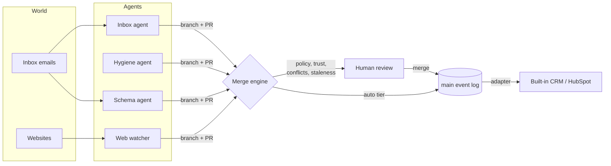

# ⎇ Mainline

**Agents never write to your CRM. They open pull requests against it.**

Mainline is a version-control layer that sits in front of a CRM. Every AI agent that wants to change customer data (an inbox agent, a dedup agent, an enrichment agent, a schema agent) works on its own **branch** and opens a **pull request**. Mainline three-way-merges those PRs into `main`, detects conflicts between agents, holds risky changes for a human, lets you **revert** any change and **time-travel** the whole CRM, and flags PRs whose evidence has gone **stale** before anyone merges them.

> 🔗 **Live demo:** https://gitcrm-production.up.railway.app · Built in one evening at **Night Hack by Founders, Inc.** (Oct 30, 2026)

---

## The problem

Companies are adding AI agents to their CRM fast: call-notes agents, enrichment tools, AI SDRs, inbox agents, cleanup bots. They all write to the same records, and today that means **last write wins**:

- the enrichment tool silently overwrites a title a rep just corrected,
- one agent bumps a deal from $20k to $45k and the board forecast changes with nobody signing off,
- a dedup bot merges two different people named "Alex Chen", and unpicking it is miserable,
- a change that was right at 9am ("move Acme to Negotiation") gets approved at 4pm, after Acme emailed to say they're pausing.

Existing tools offer an **approve-this-diff queue** (one agent, one proposal at a time, against live data). That doesn't survive many agents working **concurrently**.

## What Mainline does

| | |
|---|---|
| **Branches per agent** | Agents read `main`, write only to their own branch. They can't corrupt the source of truth. |
| **Pull requests with evidence** | Every changed field cites the email / web page / call that justifies it, with a verbatim quote. |
| **Three-way merge** | base = `main` at fork, ours = `main` now, theirs = branch. Field-level conflicts surface like git merge conflicts. |
| **Semantic rebase** | If an agent edited a contact that another agent has since merged away as a duplicate, the edit is automatically rebased onto the surviving record. |
| **Stale-decision detection** | A PR re-checks itself when new evidence lands. *"Move Acme to Negotiation"* flips to **STALE** the moment Priya's "we're pausing until Q1" email arrives. A version change triggers re-inspection; a contradiction blocks the merge. |
| **Branch protection for revenue** | Policy tiers per field: enrichment auto-merges, deal amount / stage / close date and merges need a human, deletes are blocked. |
| **Agents earn trust** | Each agent has a track record (merged / reverted / stale). Agents move from probation → trusted → autonomous, but money, pipeline stage, identity merges and schema always need a human. |
| **Schema is data** | Schema changes live in the same event log, so "add `deal.procurementContact` and backfill 3 deals" is a PR you can review, merge and revert. |
| **Revert + time travel + blame** | Every field has a full history (who, when, why, evidence). Revert any PR by writing inverse events. Drag a slider to see the CRM as it was on any date. |

## Demo (90 seconds)

1. **Chaos mode:** four agents write straight to the CRM. The forecast silently inflates, a bad dedup merges two different people, agents overwrite each other.
2. **Governed mode:** same agents, same data, now on branches. PRs stream in live.
3. A **conflict** between the inbox agent and the web watcher (Northwind headcount 250 vs 220); a contact edit **auto-rebased** onto its merge survivor; a $25k amount bump **held for review**.
4. Inject the *"we're pausing"* email → the open Acme PR flips to **stale** on its own.
5. The schema agent proposes a new field → merge → existing deals backfill.
6. **Time travel** the CRM back a week, then **one-click revert** the bad dedup.

## How it works



- **Event-sourced core.** Nothing is ever overwritten. Every change is an immutable `Event` (`entity.create`, `field.set`, `entity.merge`, `schema.addField`, `evidence.attach`, …) with its actor, reason and evidence. CRM state is a fold of the log.
- **Merge engine** (`src/core/engine/merge.ts`): rebases branch events onto `main`, classifies conflicts (`field`, `deleted`, `merged-away`, `schema`), applies resolutions, and generates inverse events for revert.
- **Staleness** (`src/core/staleness.ts`): read-set version checks plus an evidence judge (deterministic heuristics, or Claude when an API key is present).
- **Policy & trust** (`src/core/policy.ts`): branch-protection rules over fields and op types, adjusted by each agent's track record.
- **Agents** (`src/agents/*`): every agent works fully **deterministically without an API key**, and uses Claude for extraction and judgement when one is set.
- **Adapters** (`src/adapters/*`): `main` is pushed to a target CRM. The built-in CRM is the default; a HubSpot adapter maps merged changes to HubSpot CRM v3.

The LLM only ever **proposes**. Correctness comes from the engine.

## Use it with your CRM

Mainline is a layer, not a new CRM. Reps keep working in HubSpot or Attio; agents keep calling what looks like their CRM's API.

**1. Chrome extension: review agent changes on the CRM record itself.**
Open any deal, contact or company in HubSpot or Attio (Salesforce and Pipedrive pages are recognised too) and the Mainline side panel shows that record's pending agent PRs: field diff, evidence quotes, policy and staleness, **Approve & merge / Reject**, plus per-field history. It reads only the tab URL, never the page.

- Download: [`/mainline-extension.zip`](https://gitcrm-production.up.railway.app/mainline-extension.zip) (or the [`extension/`](extension) folder)
- Install: unzip → `chrome://extensions` → **Developer mode** → **Load unpacked** → pick `mainline-extension` → click the violet icon
- Guide: [`/extension`](https://gitcrm-production.up.railway.app/extension). Not on the Chrome Web Store yet (store review takes days).

**2. Connectors: mirror your CRM into `main`, write merged PRs back.**
Set `HUBSPOT_TOKEN` (private app, `crm.objects.companies/contacts/deals` read + write) and/or `ATTIO_TOKEN` (records read-write, object configuration read). Mainline imports records, polls for human edits (which is what makes conflicts and staleness real), and writes merged changes back. **Settings → Integrations** has one-click *Seed demo data* and *Import now*.

**3. Drop-in API proxy: your existing agents don't change.**
Swap one base URL and every write becomes a reviewable PR:

```bash
curl -X PATCH https://gitcrm-production.up.railway.app/api/proxy/hubspot/crm/v3/objects/deals/acme-platform \
  -H 'content-type: application/json' -H 'x-mainline-agent: sdr-bot' \
  -d '{"properties":{"amount":"45000","dealstage":"contractsent"}}'
# → 202 {"mainline":{"status":"pending_review","pr":"pr_1","tier":"review","reasons":["deal.amount $20,000 → $45,000 (+$25,000) exceeds $10k threshold", …]}}
```

An Attio-compatible proxy lives at `/api/proxy/attio/v2/objects/{object}/records/{id}`.

## Tech

Next.js 15 (App Router) · TypeScript · server-sent events for live updates · Vitest · Claude (Anthropic API) for agent reasoning and the staleness judge · Firecrawl for live account scraping ("Watch account by URL") · HubSpot CRM v3 and Attio v2 connectors · Manifest V3 Chrome extension · deployed on Railway as a single Node process.

## Run it

```bash
npm install
npm run dev          # http://localhost:3000
npm test             # engine, agents, store, API tests
```

Optional env vars: `ANTHROPIC_API_KEY` (LLM mode for agents and the staleness judge), `MAINLINE_MODEL`, `FIRECRAWL_API_KEY`, `HUBSPOT_TOKEN`, `ATTIO_TOKEN`, `MAINLINE_DATA_DIR` (persist the event log to disk). Everything works without any keys: agents and the staleness judge fall back to deterministic logic.

## Repo map

```
src/core/types.ts            domain model (events, branches, PRs, conflicts, policy)
src/core/engine/state.ts     fold, time travel, blame, diff
src/core/engine/merge.ts     three-way merge, conflicts, semantic rebase, revert
src/core/staleness.ts        stale-decision detection
src/core/policy.ts           branch protection + agent trust
src/server/repo.ts           application service (branch → PR → analyze → merge)
src/app/api/**               HTTP API + SSE stream
src/agents/{inbox,hygiene,schema,webwatch}
src/seed/**                  demo world: 10 companies, ~25 contacts, ~10 deals, ~30 emails
src/app/**                   UI: overview, PR review, CRM tables, time travel, demo console, settings
src/integrations/{hubspot,attio}   sync, mapping, API-compatible proxies, seeding
src/adapters/**              write-back to HubSpot / Attio on merge
extension/                   Chrome extension (MV3 side panel, no build step)
```

## What was built tonight

Everything in this repo was written during the Night Hack sprint (4:15pm–9pm, Oct 30, 2026), starting from an empty folder. The demo world (companies, contacts, emails, web pages) is **synthetic** and seeded on boot; the collisions in it are planted on purpose so the demo is reproducible. See [`STORY.md`](STORY.md).

Built with Claude: the architecture and contract were written first, then the work was split across parallel Claude workers that each owned one module (see [`CONTRACT.md`](CONTRACT.md)).
